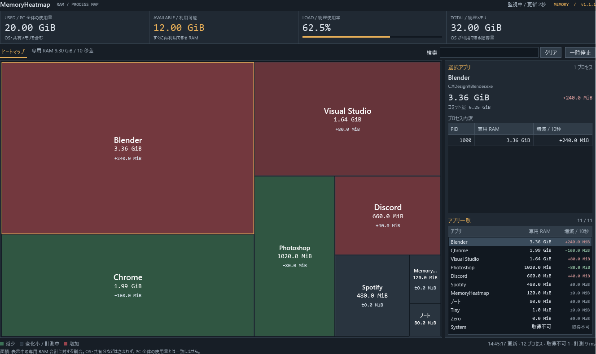

# MemoryHeatmap

Windows のアプリ別メモリ使用量を、株価マップ風のヒートマップで表示するツールです。
四角の面積が専用 RAM 使用量、赤・緑の色が約 10 秒前からの増減を示します。



## ダウンロード

**v1.1.1 / Windows 11 x64 / 右クリック操作・プレビュー版**

- [MemoryHeatmap-v1.1.1-win-x64.zip](https://github.com/mezon-web/MemoryHeatmap-Releases/releases/download/v1.1.1/MemoryHeatmap-v1.1.1-win-x64.zip)
- [ZIP の SHA-256](https://github.com/mezon-web/MemoryHeatmap-Releases/releases/download/v1.1.1/MemoryHeatmap-v1.1.1-win-x64.zip.sha256.txt)
- [画像付きの使い方をダウンロード（単一 HTML）](https://github.com/mezon-web/MemoryHeatmap-Releases/releases/download/v1.1.1/MemoryHeatmap-v1.1.1-manual.html)
- [リリースページ](https://github.com/mezon-web/MemoryHeatmap-Releases/releases/tag/v1.1.1)

**.NET 10 Desktop Runtime（Windows x64）が必要です。実行環境は同梱していません。**
未導入の場合は [Microsoft の .NET 10 配布ページ](https://dotnet.microsoft.com/en-us/download/dotnet/10.0)から「.NET Desktop Runtime」の Windows x64 を導入してください。

ZIP を展開し、`MemoryHeatmap.exe` をダブルクリックすると起動します。インストール・管理者権限は不要です。
EXE は単独で移動できます。Windows 11 22H2 の 2023 年 9 月更新以降が対象です。

## できること

- 同じ実行ファイルのフルパスでプロセスを合算し、専用 RAM 使用量の面積比で表示。
- 約 10 秒前との差を数値と赤／緑で表示。2 秒ごとに更新。
- アプリ名、PID、パスで検索。選択アプリの PID 別内訳とコミット量を確認。
- 一時停止／再開、小さい四角のツールチップ、キーボード操作。
- PC 全体の使用量、利用可能量、使用率を表示。

日本語 UI、オフライン動作。右クリックから対象を確認して、メモリ整理・タスク終了・ファイルの場所を開く操作ができます。自動整理・自動常駐は行いません。

## 表示の読み方

赤は増加、緑は減少、暗色は変化が小さい状態または計測中です。1 MiB 未満の変化は暗色で、数値にはその差も表示します。
起動直後や再開直後は約 10 秒分の履歴を集めます。初回は使用量順で、その後は既存アプリの並びを維持します。

面積の基準は、表示中に取得できたアプリのプライベートワーキングセットです。
OS・共有メモリなどを含む PC 全体の使用量とは一致しません。通常権限で情報を取得できないプロセスは「取得不可」となり、ゼロとして扱いません。

タスク終了は強制終了で、未保存のデータが失われる可能性があります。メモリ整理後もコミット量は残り、再アクセスで RAM 使用量が戻る場合があります。

詳しくは [使い方（テキスト）](使い方.txt) と [検証記録](validation-v1.1.1.md) を参照してください。
画像付き HTML は ZIP にも含まれ、ファイルを開くだけでオフライン閲覧できます。画像はすべて架空データによる画面例です。

## ファイルの確認

PowerShell で ZIP の SHA-256 を計算し、配布している `.sha256.txt` の値と照合できます。

```powershell
Get-FileHash .\MemoryHeatmap-v1.1.1-win-x64.zip -Algorithm SHA256
```

ZIP の内容は `MemoryHeatmap.exe`、`使い方.txt`、`使い方.html` です。
GitHub が自動表示する **Source code (zip / tar.gz)** は、この案内リポジトリの文書です。アプリを利用する場合は上記の名前付き ZIP をダウンロードしてください。

このリポジトリは配布案内用です。アプリの開発ソースは非公開リポジトリで管理しています。

## 更新履歴

- [v1.1.1 — 右クリックメニューの区切り線を修正](release-notes/v1.1.1.md)

- [v1.1.0 — 右クリックからの手動整理・タスク終了](release-notes/v1.1.0.md)

- [v1.0.1 — メモリ最適化と内部整理](release-notes/v1.0.1.md)
- [v1.0.0 — 初回プレビュー版](release-notes/v1.0.0.md)
